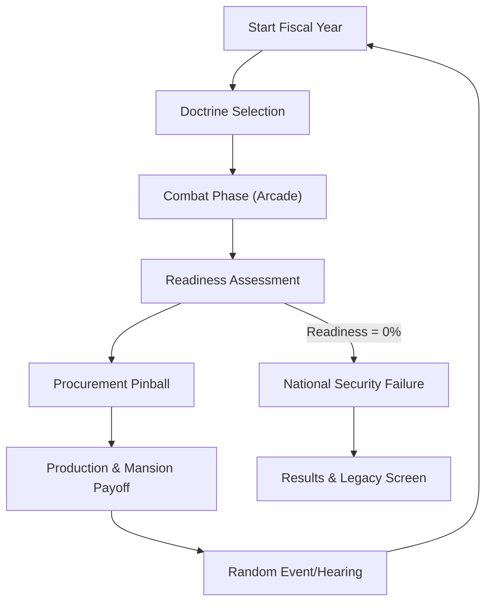

## Procurement experiment — 2026-09-11

Transition procurement pinball on this branch to Three.js + Rapier 3D with real elevated ramps, parameterized rails, responsive flippers, mobile touch and editorial-cartoon art. Planck remains on `main` for comparison and rollback. Success requires measured improvements in authoring and playability while passing mobile/lifecycle gates. See [plan](../../PINBALL_3D_IMPLEMENTATION_PLAN.md) and [evaluation](../../PINBALL_3D_EVALUATION.md). Full kit expansion follows the vertical slice.

## Current implementation and evidence — 2026-10-28

The current game has five combat scenarios; seeded campaign choices reorder doctrine cards and offset the fiscal-year scenario cycle. This does not seed pinball physics. Procurement board content has three upper-board bumper/scoop layouts sharing the protected shooter lane, ramps, and lower-playfield/flipper structure. Treat board unlock/rule integration and distinct gameplay rules as open product work; do not describe the three boards as fully independent physics systems. Verification snapshot: 129 tests across 16 files, 33 geometry checks, production build passes with a large-chunk warning. Headless smoke stalled. Physical-device performance and human-play validation remain unverified.

## 1. Product Overview
**Department of WARRR** is a political satire 2D arcade/strategy game about perverse procurement incentives, excessive spending, and the wealth manifest as luxury mansions in McLean, Virginia. Players aim to build mansions by wasting expensive munitions on cheap threats, creating procurement emergencies, and navigating a bloated defense industry.

- **Main Purpose**: Satirize the military-industrial complex through engaging arcade and strategic gameplay.
- **Problem to Solve**: Creating a mechanically fun game that highlights economic absurdity without relying solely on text-based jokes.
- **Target Users**: Fans of strategy games, arcade shooters, and political satire.
- **Market Value**: Unique blend of arcade combat and economic simulation with a strong, distinctive aesthetic.

## 2. Core Features

### 2.1 Feature Module
1. **Combat Module**: Portrait battlefield, tap-to-launch airburst interceptors (Missile Command style), weapon switching (Gun, Jammer, Interceptor).
2. **Readiness & Logistics Module**: Global and theater-level inventory management, theater readiness penalties, and strategic resource transfers.
3. **Procurement Pinball Module**: Physics-based pinball game to inflate contract values and delivery lead times for maximum "grift."
4. **McLean Mansion Module**: Persistent neighborhood visualization of built mansions, serving as the player's primary score and trophy case.
5. **Simulation Engine**: Data-driven systems for economy, production queues, lead times, and overmatch calculations.

### 2.2 Page Details
| Page Name | Module Name | Feature Description |
|-----------|-------------|---------------------|
| Combat Scene | Battle View | Protect target at bottom, engage drones/missiles from top, track Taxpayer Burn. |
| Readiness Scene | Theater Map | View theater statuses, transfer munitions between theaters, manage global readiness. |
| Procurement Scene | Pinball Board | Launch "requirement" ball, hit bumpers to inflate cost/delay, authorize contracts. |
| Mansion Scene | Neighborhood | View built mansions in McLean, construction animations, persistent meta-progression. |
| Result Scene | Legacy View | Final run stats: Fiscal Years survived, Burn rate, Overmatch ratio, Mansions built. |

## 3. Core Process
The game follows a cyclical loop representing Fiscal Years:
1. **Doctrine Choice**: Choose a strategic card that modifies the upcoming year.
2. **Combat Phase**: Defend against threats while maximizing overmatch combos.
3. **Readiness Phase**: Manage shortages and theater transfers.
4. **Procurement Phase**: Play pinball to turn shortages into massive contracts.
5. **Production/Mansion Phase**: Update delivery queues and build mansions based on contractor profit.
6. **End of Year**: Optional random event/hearing before starting the next Fiscal Year.

## 4. User Interface Design

### 4.1 Design Style
- **Aesthetic**: Editorial political cartoon + retro government propaganda + polished mobile arcade.
- **Primary Colors**: Bureaucratic greys, "Money" greens, "Alert" reds, and high-contrast alert yellows.
- **Typography**: Distinctive display fonts for satirical headers, clean functional fonts for HUD.
- **Layout**: Portrait 9:16 (1080x1920), mobile-first, touch-optimized.
- **Visual Effects**: Paperwork stamps, warning lights, money particle effects, screen shake on explosions.

### 4.2 Page Design Overview
| Page Name | Module Name | UI Elements |
|-----------|-------------|-------------|
| Combat Scene | Battlefield | Minimalist HUD (Burn, Mansions, Readiness), touch-to-aim interceptors, pooled particles. |
| Procurement | Pinball Board | Retro arcade pinball layout, satirical bumper labels (AUDIT, COST OVERRUN), digital score displays. |
| Mansion | McLean View | Stylized neighborhood map, high-end architectural illustrations, "Ding Dong" completion alert. |

### 4.3 Responsiveness
- **Portrait 9:16**: Locked orientation.
- **Touch Optimization**: Large flipper zones for pinball, precise tap-to-detonate for combat.
- **Desktop**: Centered portrait viewport with decorative borders.
