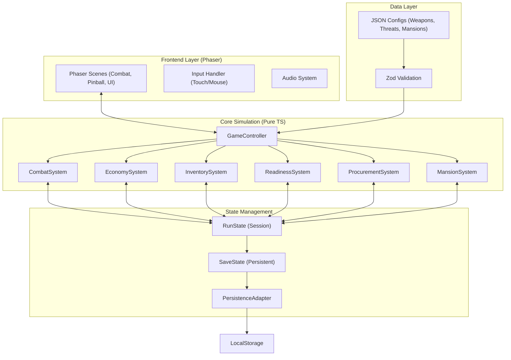

## Procurement architecture update — 2026-09-11

This branch transitions procurement from Phaser/Planck to TypeScript + Three.js + Rapier 3D within the existing Vite/Capacitor app. The Planck implementation remains on `main` as the comparison and rollback reference. See [architecture](../../PINBALL_3D_ARCHITECTURE.md) and [implementation plan](../../PINBALL_3D_IMPLEMENTATION_PLAN.md). Preserve the campaign shell. Shared component specifications generate visible and physical geometry; a host adapter owns lifecycle and a rules adapter owns campaign integration. The dated notes below describe earlier work and are not current runtime verification.

## Current architecture status — 2026-10-28

Combat scenario selection uses a seeded fiscal-year offset across five scenarios; doctrine-card order also uses the seeded campaign RNG. Those deterministic choices do not control procurement physics. The current pinball kit defines three board shells with different upper-board bumper/scoop geometry and shared protected shooter lane, dual ramps, and lower playfield/flipper structure. Automated verification snapshot: 129 tests across 16 files, 33 geometry checks, production build passes with a large-chunk warning. Headless smoke stalled; no physical-device or human-play verification is available. Earlier proposed components and status statements below are historical design notes where they conflict with current source.

## 1. Architecture Design

### Implementation Note — 2026-08-27

The current prototype uses Phaser scenes directly with `RunState` and a small set of pure gameplay helpers. The planned `GameController`, dedicated inventory/readiness/procurement/economy/mansion systems, persistence adapter, and Zod validation layers are not yet fully implemented. Procurement currently depends on Matter Physics while combat depends on Arcade Physics; this mixed-physics scene setup is an active runtime risk and is not considered stable until the Procurement smoke test passes.

The project follows a separation of concerns between the gameplay simulation (Pure TypeScript) and the rendering/interaction layer (Phaser Scenes).



## 2. Technology Description
- **Language**: TypeScript
- **Engine**: Phaser 4.x
- **Build Tool**: Vite
- **Physics**:
  - Phaser Arcade Physics (Combat)
  - Rapier 3D (procurement on this branch); Planck (main-branch reference)
- **Validation**: Zod (for game data)
- **Testing**:
  - Vitest (Unit tests for systems)
  - Playwright (E2E browser smoke tests)
- **Deployment**: Static Web App (Capacitor for mobile packaging later)

## 3. Route Definitions
As a single-page Phaser application, "routes" are managed as Phaser Scene transitions:
| Scene | Purpose |
|-------|---------|
| BootScene | Asset loading and initialization |
| MenuScene | Main title and career overview |
| DoctrineScene | Card selection for the new Fiscal Year |
| CombatScene | Main arcade gameplay |
| ReadinessScene | Theater management and munition transfers |
| ProcurementScene | Pinball gameplay and contract inflation |
| MansionScene | McLean neighborhood and construction payoff |
| ResultsScene | Run summary and legacy stats |

## 4. Data Model

### 4.1 Core State Definitions
```typescript
interface RunState {
  currentFY: number;
  globalReadiness: number;
  taxpayerBurn: number;
  contractorProfit: number;
  theaters: Record<string, TheaterState>;
  productionQueue: DeliveryBatch[];
  activePrograms: ProcurementProgram[];
}

interface ProcurementContract {
  programId: string;
  baseRequest: number;
  finalAuthorization: number;
  unitsOrdered: number;
  deliveryDelayYears: number;
  contractorProfit: number;
  executiveWealth: number;
}
```

### 4.2 Persistence
- **Current Run**: Saved to LocalStorage to survive browser suspension.
- **Career Save**: Versioned (v1) persistence for lifetime mansions, achievements, and meta-progression.

## 5. Implementation Strategy
- **Object Pooling**: Essential for combat (projectiles, threats, particles) to maintain 60 FPS on mobile.
- **Simulation/Render Separation**: No simulation logic buried in Phaser scenes; scenes only reflect state and pass input to systems.
- **Data-Driven Design**: All balancing values (speed, cost, lead time) externalized in JSON files.
